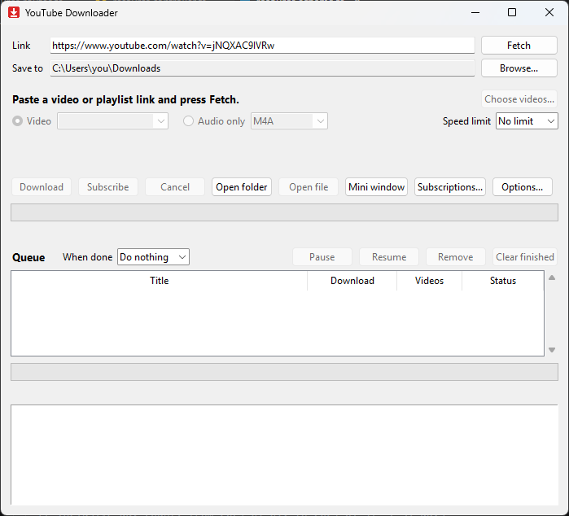

# YouTube Downloader

[](https://github.com/bassiony1/youtube-downloader/actions/workflows/ci.yml)
[](https://github.com/bassiony1/youtube-downloader/releases/latest)
[](LICENSE)

A simple Windows app to download YouTube videos, playlists, channels and audio. Paste a link, pick a quality, press Download.
Built on [yt-dlp](https://github.com/yt-dlp/yt-dlp).



## Download

**[Download YouTubeDownloader-Setup.exe](https://github.com/bassiony1/youtube-downloader/releases/latest/download/YouTubeDownloader-Setup.exe)** (Windows 10/11, 64-bit)

Run it and click Install. Setup is small: it downloads Python, yt-dlp and ffmpeg (about 150 MB) into the install folder, so nothing else on your PC changes. No admin rights needed.

> Windows SmartScreen may say "Windows protected your PC" because the installer isn't code-signed. Click **More info**, then **Run anyway**.

To update, run a newer Setup over the old one; it only downloads what changed. The app tells you when a new version is out.

## Features

**Downloading**
- Videos, playlists and whole channels, up to 4K, HDR and 60 fps, or audio only (M4A, MP3, Opus)
- Shows the size for each quality before you download
- A picker for playlists and channels, with filters: search, latest N, upload date, length, Shorts
- A download queue that survives restarts: pause, resume or remove downloads
- Interrupted downloads resume where they stopped, and the download history skips videos you already have
- Speed limit, keep-awake while downloading, and sleep or shut down when done

**Files**
- Tidy names and folders (`Playlist\01 - Title`, or the upload date for channels)
- Tags and cover art, chapters (embedded, or split into separate tracks), and subtitles
- H.264 compatibility mode for older players and TVs

**Convenience**
- Subscribe to channels: new uploads are queued automatically (checked on start and every 6 hours)
- Tray icon, mini window, and taskbar progress
- Drag a link onto the window, or send the current browser page with the browser bookmark button
- Clear error messages, and a one-click **Update yt-dlp** button for when YouTube changes

## Command line

Setup can add the `ytd` command to PATH:

```
ytd https://www.youtube.com/watch?v=jNQXAC9IVRw
```

It asks for a quality and downloads into the current folder. It shares the download history with the app.

## Run from source

Needs [uv](https://docs.astral.sh/uv/).

```
git clone https://github.com/bassiony1/youtube-downloader
cd youtube-downloader
uv run ytd-gui                  # the window
uv run python test_ytd.py       # the tests (offline)
```

`python build_installer.py` builds the Setup (needs [Inno Setup 6](https://jrsoftware.org/isinfo.php)). Releases are published with `python release.py` (see its docstring).

## Disclaimer

This tool is for downloading content you have the right to download. Respect copyright and YouTube's Terms of Service. It is not affiliated with YouTube or Google.

## License

[MIT](LICENSE)
